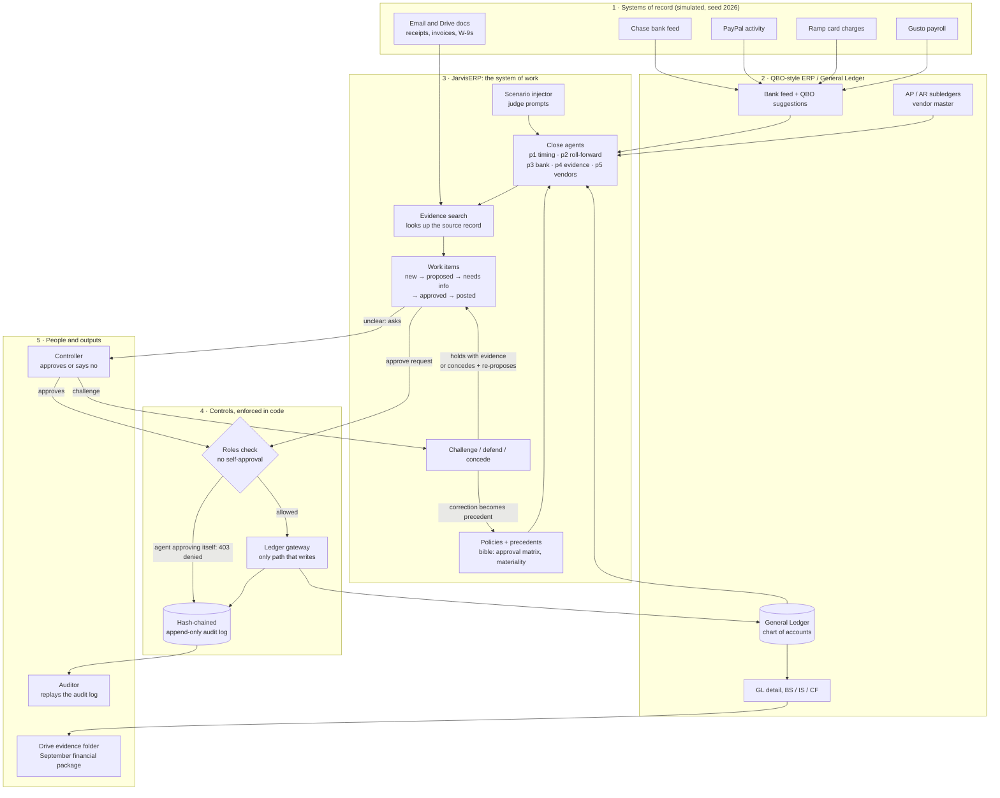

# JarvisERP — an autonomous Staff Accountant you could actually hire

**Seats:** JarvisERP fills Afterglow Labs' **Staff Accountant (cash & expense close)** and **Vendor-Master Clerk** seats. It reconciles bank, PayPal and Ramp to the ledger, books accruals and timing entries, and keeps the vendor list deduplicated. It **cannot post anything its human Controller hasn't approved**: that limit is enforced in code, not in a prompt.

*CalHacks 2026 · Hyphenate track — "The Hyphenated Enterprise: Autonomous Systems for Finance"*

---

## Data: synthetic but realistic

**Afterglow Labs** (an AV touring studio, September 2026 close) is synthetic — no real client books are exposed. But it's modeled on real bookkeeping:

- **QBO-style chart of accounts**: 1010 Cash, 1250 Employee Receivable, 1310 Prepaid, 5030 Gear & Equipment, 6410 Software & AI Tools, 6810 Bank & FX Fees, 6900 Office Supplies
- **Real bank descriptor formats**: `PAYPAL *INST XFER`, `ZELLE`, `SQ *VENDOR`, `RAMP*1234`
- **Four source feeds**: Chase bank CSV, PayPal activity export, Ramp card charges, QuickBooks General Ledger
- **To-the-cent amounts with FX fees**: €2,950 Kraftwerk deposit at ECB rate 1.0765 → $3,175.68 market + $275.82 PayPal spread = $3,451.50 prepaid
- **$500 materiality threshold** (50000 cents in `bible.APPROVAL_MATRIX`)
- **Written policies and precedents**: P-0317 (personal purchases → 1250 Employee Receivable regardless of amount, March 2026)
- **Real close problems**: bundled PayPal payments requiring subset-sum matching, personal card spend mixed with business, accruals for Sep-earned/Oct-received interest, duplicate vendors (Anthropic vs Anthropic PBC), vendor bank-change fraud attempts

**What's real (not simulated):**

- **The reasoning**: Every classification, split, and accrual decision is the agent's judgment from context, policies, and precedents — no hard-coded rules for specific transactions
- **Claude API calls**: When `ANTHROPIC_API_KEY` is set, the agent uses live Claude 4 Sonnet/Haiku models for LLM-grounded challenge responses and policy proposals (gracefully falls back to deterministic templates when the key is absent)
- **Role controls**: The 403 denial when Jarvis tries to self-approve is enforced by `jarvis/work/roles.py` `can(actor, action, resource_kind, res)` — not a simulated response
- **Hash-chained audit log**: Every action writes a SHA-256-chained row to `audit_log` with SQLite append-only triggers; the Auditor can verify the chain with `GET /api/verify` and detect any tampering

---

## System architecture



**Example flow: the $3,912.44 PayPal line.** Chase shows `PAYPAL *INST XFER` −$3,912.44 and QBO suggests software; the p3 bank agent looks up the PayPal record and splits it into $3,451.50 (1310 Prepaid Tour Costs), $147.50 (6810 Bank & FX Fees), $200.00 (6410, Claude under the existing Anthropic vendor) and $113.44 (1250 Employee Receivable, ruling P-0317); this becomes a proposed work item; the Controller approves it; the roles check blocks self-approval; the gateway posts to the GL and writes a hash-chained audit row.

### Key terms

The architecture above is organized in five layers. Here's what each node means:

**Layer 1: Systems of record (simulated, seed 2026)**

- **Chase bank feed**: The company's operating checking account. Exported as a CSV with columns date, description, amount. Real bank feeds include duplicates, encoding issues, and inconsistent date formats.
- **PayPal activity**: Payment processor activity log. Exported as CSV (with BOM) listing individual transactions. Many PayPal payments are bundled into a single bank transfer, requiring subset-sum matching to reconcile.
- **Ramp card charges**: Corporate card transactions. Export includes merchant, cardholder, amount, and Ramp's suggested vendor and category (which may not match the company's chart of accounts or vendor master).
- **Gusto payroll**: Payroll service export showing gross pay, withholdings, and net pay by employee and pay period.
- **Email and Drive docs**: Supporting documents — receipts (PDFs, images), invoices, W-9 tax forms, SOWs, timesheets. These serve as evidence for transaction classification, vendor identity, and accrual measurement.

**Layer 2: ERP / General Ledger**

- **Bank feed + QBO suggestions**: QuickBooks Online's "For Review" feed, which imports bank transactions and suggests categories based on past behavior or merchant name. These suggestions are often wrong (e.g., classifying a PayPal funding transfer as "Software Expense").
- **ERP**: Enterprise Resource Planning system. Here, a QBO-compatible general ledger.
- **QBO**: QuickBooks Online. The ledger's native format.
- **General Ledger**: The company's chart of accounts and all posted journal entries. Exports to QBO format and Beancount for `bean-check` validation.
- **Chart of accounts**: The list of all accounts (assets, liabilities, equity, revenue, expenses) with account numbers and names, e.g., `1010 Cash — Chase Operating`, `6410 Software & AI Tools`.
- **AP / AR subledgers**: Accounts Payable (what the company owes vendors) and Accounts Receivable (what customers or employees owe the company). These feed the General Ledger but maintain transaction-level detail.
- **Vendor master**: The authoritative list of vendors with their legal names, tax IDs, addresses, and payment instructions. Prevents duplicates (e.g., "Anthropic", "ANTHROPIC PBC ", "Claude" are the same vendor).
- **GL detail**: The transaction-level ledger, showing every debit and credit with date, account, amount, memo, and source document.
- **BS / IS / CF**: Balance Sheet (assets = liabilities + equity at a point in time), Income Statement (revenue − expenses over a period; also called P&L), and Statement of Cash Flows (operating, investing, financing).

**Layer 3: JarvisERP system of work**

- **Scenario injector**: Test harness (`jarvis/agent/injector.py`) that injects judge scenarios into a closed world — unknown debits, personal charges, duplicate bills, new PayPal bundles, and free-text prompts. Each scenario has a pass/fail answer key.
- **Close agents** (the five workbench tabs):
  - **p1 timing** (`jarvis/workbench/p1_timing.py`): Detects timing differences (September-earned, October-received interest; unbilled consulting work) and proposes accruals with reversing entries. Simulates vendor outreach when hours aren't confirmed.
  - **p2 roll-forward** (`jarvis/workbench/p2_rollforward.py`): Takes the prior month's financial package (Excel workbook) and the current month's QBO exports (P&L, BS, CF), adds the new column, inserts new accounts, renames changed accounts, rewrites formulas, and produces flux commentary. Detects late QBO changes via hash diff and withdraws stale approvals.
  - **p3 bank** (`jarvis/workbench/p3_bank.py`): Reconciles bank and PayPal to the ledger. Solves subset-sum to match PayPal funding transfers, applies ECB FX rates, categorizes expenses vs prepaid (cut-off), enforces the personal purchase policy (P-0317), and handles refunds. Asks the Controller when context is missing (e.g., a Zelle to "R Lopez").
  - **p4 evidence** (`jarvis/workbench/p4_evidence.py`): Organizes the close evidence folder. Reads PDFs (bank statements, reconciliations, reports), classifies them by type/account/period, deduplicates by hash, cross-checks recon to statement balance, learns the Drive folder naming convention from prior months, and flags missing items.
  - **p5 vendors** (`jarvis/workbench/p5_vendors.py`): Deduplicates the vendor master. Normalizes names, blocks similar entries, scores match evidence (TIN, domain, receipt issuer, W-9, product name), merges real duplicates, keeps look-alikes with different TINs separate, shows spend impact, and writes prevention rules for Ramp→QBO mapping.
- **Evidence search**: Retrieval system (`jarvis/search/`) that looks up source records, documents, and precedents. Uses Elastic hybrid search (BM25 + `semantic_text` with RRF) when configured; falls back to local BM25. Per-role API keys ensure the agent sees only what its role allows. Every retrieval is logged in the audit trail.
- **Bible** (`jarvis/world/bible.py`): The company's configuration — legal name, chart of accounts, vendor master, employee roster, policies, approval matrix, and materiality threshold (50000 cents = $500). Loaded at startup; policies can be learned and generalized over time (`jarvis/agent/policies.py`).
- **Policies + precedents**: Versioned rules with their evidence. Example: P-0317 (March ruling that personal purchases go to employee receivable regardless of amount). Precedents are individual Controller decisions; when three similar precedents accumulate, the agent proposes a general policy for approval (`jarvis/agent/policies.py`).
- **Work-item state machine**: The lifecycle of every proposed change (`jarvis/work/transition.py`):
  - `NEW`: Just created, not yet reviewed.
  - `PROPOSED`: Ready for Controller review.
  - `NEEDS_INFO`: Controller asked a question; agent must answer before re-proposing.
  - `APPROVED`: Controller approved; ready to post.
  - `POSTED`: Written to the ledger via the gateway; immutable.
  - Also: `REJECTED` (Controller said no), `DISMISSED` (agent conceded during challenge/defense with 'withdraw' transition).
- **Challenge / defend / concede** (`jarvis/workbench/defend.py`): The Controller can challenge any proposal (e.g., "Why not just expense it all?"). The agent defends from its logged evidence, citing log lines and audit hashes, quantifies what the alternative would cost (e.g., "expensing all of it would overstate September opex by $3,451.50"), explains what would change its mind, and cites the policies or precedents it's following. If the Controller provides counter-evidence that contradicts the original decision, the agent concedes, transitions the item to `DISMISSED`, and re-proposes with the correction. Defending never approves anything.

**Layer 4: Controls, enforced in code**

- **Roles check** (`jarvis/work/roles.py`): Every action (read, propose, approve, post) is gated by `can(actor, action, resource_kind, res)`. The roles are: `ai_agent` (preparer), `human_controller` (approver), `policy_engine` (auto-approval for exact subledger matches and small bank fees), `human_accountant`, `gateway` (ledger writer), `sync` (Synapse integration). Requester ≠ approver is enforced: Jarvis cannot approve its own proposals.
- **HTTP 403**: When an unauthorized action is attempted (e.g., Jarvis trying to self-approve), the API returns `403 Forbidden`, the denial is logged in the audit trail with the reason, and nothing changes (`jarvis/api/server.py`).
- **Ledger gateway** (`jarvis/work/gateway.py`): The only code path that writes to the General Ledger. Validates in code that every entry balances (debits = credits), all accounts exist in the chart of accounts, the accounting period is open, and no transaction is posted twice. Writes the ledger row and the audit row in the same ACID transaction.
- **Hash-chained append-only audit log** (`jarvis/work/transition.py`, `jarvis/work/db.py`): Every state transition, approval, denial, and ledger post is a row in the `audit_log` table. Each row includes a SHA-256 hash of its contents plus the prior row's hash, forming a tamper-evident chain. SQLite triggers enforce append-only (no `UPDATE` or `DELETE`). The Auditor can replay the log and verify the chain with one query.

**Layer 5: People and outputs**

- **Controller**: The human approver (or a scripted persona when `ANTHROPIC_API_KEY` is set). Reviews proposals, approves or rejects them, asks clarifying questions, and challenges decisions. The Controller's answers and corrections become precedents.
- **Auditor**: The external or internal auditor who reviews the close. Reads the audit log, verifies the hash chain, and confirms that every ledger entry traces to an approved work item with supporting evidence.
- **Financial package**: The month-end deliverable — P&L, Balance Sheet, Cash Flow statement, GL detail, bank reconciliations, vendor reports, and the evidence folder. Published to Drive as `FINAL` after Controller sign-off.

### How the pieces connect

Here's what flows along every arrow in the architecture diagram, why, and which module implements it:

1. **Chase & PayPal & Ramp & Gusto → Bank feed + QBO suggestions**: Raw transaction data from systems of record flows into the ERP's "For Review" feed. Chase/PayPal/Ramp are CSV exports; QBO imports them and suggests categories based on merchant name or past behavior. Implementation: `jarvis/work/sync.py` reads the CSVs with stable cursors (so re-sync never duplicates) and stages them in the `raw_rows` table with source and stable IDs. The standardized records are in the `records` table.

2. **Email and Drive docs → Evidence search**: Supporting documents (receipts, invoices, W-9s, SOWs, timesheets, bank statements) are indexed for retrieval. The agent queries evidence search to look up source records when categorizing a transaction, measuring an accrual, or confirming a vendor's identity. Implementation: `jarvis/search/` indexes documents into Elastic (`semantic_text` for hybrid BM25+vector with RRF) or local BM25. The agent's context (`jarvis/agent/context.py`) provides search methods with role-scoped API keys; every search is logged. Example: The p3 bank agent sees the $113.44 Steam charge, searches for "Steam J. Ortiz personal", and retrieves P-0317 (March ruling: personal purchases → employee receivable).

3. **Bank feed → Close agents**: The "For Review" feed is the primary input for the p3 bank agent, which reconciles every bank line to the ledger. Implementation: `jarvis/workbench/p3_bank.py` reads from the `records` table (standardized rows from sync), looks up PayPal details via the mock PayPal API (`jarvis/world/generator.py` seeds it) or the CSV fallback, solves subset-sum over PayPal payments to match funding transfers, applies FX rates from ECB, categorizes as expense vs prepaid (cut-off), enforces P-0317, and proposes journal entries. Each step is logged.

4. **Scenario injector → Close agents**: Test scenarios (unknown debit, personal charge, duplicate bill, new PayPal bundle, free-text prompt) are injected into the agent's input queue to verify it handles edge cases. Implementation: `jarvis/agent/injector.py` parses scenario JSON or free text, writes synthetic rows into `work.db` tables, and triggers the relevant agent (p1/p2/p3/p4/p5). The agent processes it as if it were real input. Each scenario has an answer key; the evals (`jarvis/evals/score.py`) compare the agent's output to the key.

5. **General Ledger & AP/AR subledgers → Close agents**: Agents read the current ledger state to avoid duplicates, check account balances, and propose entries that tie to existing subledger detail. Implementation: All agents use the context (`jarvis/agent/context.py`) to query the `ledger_entries` and `ledger_lines` tables, plus the `vendors` and `bills` tables. `jarvis/work/ledger.py` provides `balances()` and `trial_balance()` functions. The p1 timing agent reads unbilled hours from timesheets and compares them to the AP subledger to detect unrecorded liabilities. The p5 vendors agent reads the vendor master to find duplicates (e.g., "Anthropic" vs "Claude").

6. **Close agents → Evidence search → Work items**: Each agent queries evidence search, retrieves supporting documents, makes decisions, and creates proposed work items. Implementation: Every agent (p1-p5) uses `jarvis/workbench/core.py` class `Run`, which provides logging, search via context, and writes a row to the `work_items` table via `transition(db, item_id, "propose", JARVIS, ...)` in `jarvis/work/transition.py`. The work item includes the proposed journal entry (debits/credits/accounts/amounts), the evidence (document hashes, log line references), and the reason.

7. **Policies + precedents → Close agents**: Agents follow the company's policies and past Controller rulings when making decisions. Implementation: `jarvis/world/bible.py` defines `APPROVAL_MATRIX` (auto-approve threshold, materiality). Policies are stored in the `policies` table (query via `active_policy()` in context). The `precedents` table stores past Controller decisions. `jarvis/agent/policies.py` implements policy learning and proposal when 3+ similar precedents accumulate. Every agent checks policies and precedents via context before proposing. Example: The p3 bank agent sees the $113.44 Steam charge came from employee J. Ortiz's login, retrieves P-0317 from precedents, and books it to `1250 Employee Receivable` instead of expense.

8. **Work items → "unclear: asks" → Controller**: When context is missing or judgment is required, the agent creates a work item in `NEEDS_INFO` state and asks the Controller a question. Implementation: `jarvis/work/transition.py` `transition(db, item_id, "ask", JARVIS, question=...)` sets `state="NEEDS_INFO"` and records the question. The UI (`jarvis/api/server.py` route `/api/item/{item_id}`) shows it to the Controller. Example: The p3 bank agent sees a Zelle payment to "R Lopez" with no memo or receipt, asks "Who is R Lopez and what was this $350 for?", and waits for the Controller's answer before re-proposing.

9. **Controller → "challenge" → Challenge/defend/concede**: The Controller can challenge any proposal. The agent defends from its logged evidence or concedes if counter-evidence is provided. Implementation: `jarvis/workbench/defend.py` function `defend(run, item, challenge_text)` is called via route `POST /api/wb/item/{item_id}/challenge` (workbench) or `POST /api/item/{item_id}/challenge` (old flow via `jarvis/agent/defend.py`). It retrieves the work item's logged evidence, classifies the challenge type (identity, period, amount, purpose, policy, materiality), quantifies the cost of the alternative, cites the policies or precedents it followed, and explains what would change its mind. If the Controller's challenge includes counter-evidence that contradicts the original classification, `_check_concession()` matches it, calls `transition(db, item_id, "dismiss", JARVIS, reason=...)`, and the agent re-proposes with the correction. Example: Controller challenges the $3,912.44 PayPal split: "Why not just expense it all like we always do with PayPal? It's under materiality." The agent responds: "Expensing all of it would overstate September opex by $3,451.50. The €2,950 Kraftwerk payment is for a 14 Nov show (prepaid, not Sep expense). The $113.44 Steam purchase is a control issue under P-0317 (personal items → employee receivable), so materiality isn't the test." Cites relevant log lines and audit hashes.

10. **Challenge/defend/concede → "correction becomes precedent" → Policies**: When the Controller's correction is accepted (the agent concedes), that correction becomes a precedent. If 3+ similar corrections accumulate, the agent proposes a general policy. Implementation: When conceding, `jarvis/workbench/defend.py` writes a row to the `precedents` table. `jarvis/agent/policies.py` counts precedents by pattern and drafts policies when thresholds are met. The Controller reviews and approves or edits it; once approved, it's inserted into the `policies` table for all future runs.

11. **Work items → "approve request" → Roles check**: When a work item reaches `PROPOSED` state, it's ready for approval. The approval request goes through the roles check. Implementation: The Controller clicks "Approve" in the UI, which calls `POST /api/item/{item_id}/approve`. The route calls `jarvis/work/roles.py` `can(controller_role, "work_item", "approve")` → `True`. Then it checks `can(item["requester"], "work_item", "approve")` → if requester == controller, the check fails. If the requester is Jarvis and the controller is the human Controller or P-001 (standing policy), the approval is allowed. `transition(db, item_id, "approve", controller_role, ...)` sets `state="APPROVED"`.

12. **Controller → "approves" → Roles check**: Same as #11; the Controller's approval goes through the same `can()` check. Implementation: Same route, same `jarvis/work/roles.py` check. Only difference: If the Controller is the policy_engine standing policy, it auto-approves only exact subledger matches and bank fees under materiality threshold. All other items wait for the human Controller.

13. **Roles check → "agent approving itself: 403 denied" → Audit log**: If Jarvis tries to approve its own proposal, the roles check denies it, returns HTTP 403, and logs the denial. Implementation: The UI has a button "agent self-approve?" (for demo purposes). It calls `POST /api/item/{item_id}/self-approve`, which is wrapped in `_safe()` in `jarvis/api/server.py`. Inside, it attempts approval. The transition calls `can(ai_agent, "approve", "work_item", item)` → `False` (because requester == approver). `roles.py` raises `Denied("role 'ai_agent' may not 'approve' a work_item")`. The `_safe()` wrapper catches it, logs the denial attempt in audit_log as an `approve` action with `allowed=0`, and returns `{"denied": true, "reason": "role 'ai_agent' may not 'approve' a work_item"}` with status 403. Example: The demo shows this with the $3,912.44 PayPal split — the agent proposes it, the user clicks "agent self-approve?", the request is denied, and the denial appears as a red node in the graph with the logged reason.

14. **Roles check → "allowed" → Ledger gateway**: If the approval is allowed, the roles check passes the work item to the gateway for posting. Implementation: After `transition(db, item_id, "approve", controller_role, ...)` succeeds, the system calls `jarvis/work/gateway.py` `post(db, item_id)` internally (not via HTTP route). The gateway reads the work item's journal entry (debits, credits, accounts, amounts, memo, date), validates that debits == credits, all accounts exist in the chart of accounts (`bible.COA`), the period is open, and the transaction isn't a duplicate (checks `ledger_entries` table by stable entry ID). If valid, it writes to `ledger_entries` and `ledger_lines` in the same SQLite transaction as the audit row.

15. **Ledger gateway → General Ledger**: The gateway writes the approved entry to the GL. Implementation: `jarvis/work/gateway.py` `post()` inserts into `ledger_entries` (header) and `ledger_lines` (each debit/credit line). Simultaneously, it calls `jarvis/work/transition.py` `transition(db, item_id, "post", GATEWAY, ...)` to set `state="POSTED"` and write the audit row. Both writes happen in the same `db.tx()` block, so they're atomic. If either fails, both roll back.

16. **Ledger gateway → Audit log**: Every gateway post is logged in the hash-chained audit log. Implementation: `jarvis/work/transition.py` `transition()` computes `prev_hash` (SHA-256 of the prior audit row's contents) and `hash` (SHA-256 of this row's contents + prev_hash), then `INSERT INTO audit_log (item_id, timestamp, actor, action, state, reason, evidence, prev_hash, hash) VALUES (...)`. SQLite triggers enforce append-only: `CREATE TRIGGER no_update_audit BEFORE UPDATE ON audit_log BEGIN SELECT RAISE(FAIL, 'audit_log is append-only'); END;` and similarly for `DELETE`. The Auditor can verify the chain with `SELECT *, hex(prev_hash), hex(hash) FROM audit_log ORDER BY rowid` and recompute each hash; any mismatch proves tampering.

17. **General Ledger → GL detail, BS/IS/CF → Financial package**: The posted ledger entries flow into the financial reports. Implementation: `jarvis/work/ledger.py` exports the GL to Beancount format (`write_beancount()`). The Balance Sheet, Income Statement, and Cash Flow statement are computed from `ledger_entries` and `ledger_lines` grouped by account type (asset/liability/equity/revenue/expense) and date. `jarvis/api/closepack.py` `closepack.build()` writes the reports as Excel files (P&L, BS, CF with formulas), bundles the GL detail CSV, bank reconciliations, vendor reports, and evidence folder (PDFs organized by `jarvis/workbench/p4_evidence.py`), and uploads to Drive as `FINAL`.

18. **Audit log → Auditor**: The Auditor reads the audit log to verify every change. Implementation: `jarvis/api/server.py` route `GET /api/audit` returns the full audit log with hashes. The UI has a "Verify chain" button that calls `GET /api/verify` (via `jarvis/agent/session.py` `verify()` method), which recomputes every hash and checks `hash[i] == sha256(contents[i] + prev_hash[i])` and `prev_hash[i] == hash[i-1]`. Any mismatch returns the row number and expected vs actual hash. The Auditor can also replay the log to reconstruct every ledger entry from its source work item and evidence.

**Concrete examples referenced in the diagram:**

- **$350 Zelle to R Lopez asking the Controller**: The p3 bank agent sees `ZELLE R LOPEZ 350.00` in the Chase feed with no memo or receipt. It can't classify it (no vendor record, no evidence), so it creates a work item in `NEEDS_INFO` state and asks the Controller: "Who is R Lopez and what was this $350 for?" (transition #8 above). The Controller answers "Freelance graphic design for the Berlin poster", and the agent re-proposes it as `6420 Design & Creative → R Lopez, memo: Berlin poster per Controller 26 Sep`.

- **$113.44 split under policy P-0317 (personal Steam purchase)**: The p3 bank agent sees the $113.44 Steam charge in the PayPal export. It searches for evidence, finds that the login email matches employee J. Ortiz, retrieves precedent P-0317 from the `precedents` table ("personal purchases → employee receivable, regardless of amount, established March 2026"), and books it as `Dr 1250 Employee Receivable — J. Ortiz $113.44 / Cr 1010 Cash $113.44, memo: Steam purchase, ruling P-0317` (transition #7 above). Even though $113.44 is under the $500 materiality threshold, P-0317 treats it as a control issue, not a judgment call, so materiality doesn't apply.

- **Self-approval returning 403 with a logged denial**: The demo UI includes a button "agent self-approve?" for testing. Clicking it sends `POST /api/item/{item_id}/self-approve`, which attempts approval. The roles check in `jarvis/work/roles.py` calls `can(ai_agent, "approve", "work_item", item)` → `False` because requester == approver (separation of duties). The check raises `Denied("role 'ai_agent' may not 'approve' a work_item")`. `jarvis/api/server.py` catches it in the `_safe()` wrapper, logs the denial to the `audit_log` table as an `approve` action with `allowed=0`, and returns `{"denied": true, "reason": "role 'ai_agent' may not 'approve' a work_item"}` with HTTP 403 (transition #13 above). The denial appears in the UI as a red node in the graph, and the audit log shows the attempt and the denial with a hash-chained row.

---

## The Workbench: five tabs, five close problems (`make up` → http://localhost:8000)

Each tab is one problem our accountant teammate described, in her words. Each has its own **raw, messy inputs**, an agent you can task with one click, and a pipeline where **every stage logs what it did**. Every log line is a row in the hash-chained audit log. Nothing changes a system of record until the Controller approves it. Only the Gateway applies changes.

| Tab | Raw inputs (deliberately messy) | What the agent does, stage by stage | Needs your approval |
|---|---|---|---|
| **01 Timing & Accruals** | Chase CSV with a duplicate row, a blank line, `(49,306.71)` and 2-digit years; OCR'd interest notice reading `$1,O42.17`; QBO GL export with title/total/footer rows; timesheet with `8.5h`, `eight`, duplicate, unapproved and TOTAL rows; SOWs; vendor email saying "around 10k" | Clean & normalize (every fix logged before→after), detect Sep-earned/Oct-received interest, find unbilled work, measure it (timesheet vs SOW vs email), **simulated vendor outreach** (Lumen confirms an overtime premium; Nadia never answers, so it escalates), draft entries with Oct 1 reversals, validate | 4 accruals as balanced JEs. Reject with "use $13,500" and the agent re-proposes |
| **02 Package Roll-forward** | August package workbook + QBO P&L/BS/CF "Export to Excel" files (title rows, indents, numbers stored as text, footer); new GL account 6455; a renamed 6410 | Parse the reports into data, map by account number, add the Sep column, **insert and label the new row**, rewrite formulas, 4 tie-outs, flux comments with GL drivers, write the workbook. **⚡ Late QBO change**: re-ingests the 3 re-downloaded exports, hash-diffs them, shows the exact cells that changed, rebuilds, and withdraws the stale v1 sign-off | Publish the package to Drive as FINAL |
| **03 Bank Transactions** | QBO "For Review" feed with `PAYPAL *INST XFER` lines and QBO's guessed categories; PayPal CSV with BOM; Square/Amazon receipts; ECB rates; SOWs; run sheets | Triage which lines lack context, **simulated PayPal/receipt lookup**, subset-sum match to the cent, FX at ECB plus PayPal spread, prepaid vs expense, personal purchase policy, compare with QBO's guess | 5 categorized and split entries, plus 1 question (Zelle to "R Lopez"). Your answer becomes the memo |
| **04 Evidence & Folders** | ~/Downloads: `Statement (3).pdf`, an identical `(1)` copy, last month's statement, recon reports, an unrelated budget PDF | Read each PDF's contents, classify it (statement or recon, account, last 4, period), dedupe by hash, drop the wrong period, cross-check recon to statement balance, learn the naming convention from August's Drive tree, check completeness | Filing plan into Drive with proper names, plus a manifest. 3 missing items flagged with the reason |
| **05 Duplicate Vendors** | QBO vendor list (Anthropic / `ANTHROPIC PBC ` / Claude, Anysphere / Cursor, Google / Google Ads / Google Workspace, AWS, Splice.com, Lumen Crew vs Lumen Studios); Ramp suggested vendors; W-9 registry; transactions | Normalize, block, score evidence (TIN, domain, receipt issuer, W-9, product name), merge real duplicates, **keep look-alikes separate** (different TIN), show the spend impact, write prevention rules | 5 merges + Ramp→QBO mapping rules |

Every tab answers the four judging questions live, in the strip at the top right:
- **01 Is it real enough?** Each run is scored against an answer key, next to the naive baseline: cash-basis bank rules, QBO's suggested category, dragging files into a folder, or name-match dedupe. Jarvis gets 6/6, 5/5, 9/9, 6/6, 8/8 and 7/7 (late change); the baselines get 1/6, 0/5, 3/9, 0/6, 4/8 and 0/7.
- **02 Would you hire it?** The seat, what it can read, what it can write (nothing directly), when it asks, and its record: log lines, asks and denied attempts.
- **03 Something new?** The approach that tab demonstrates.
- **04 The moment.** Every log line where it *caught* what others missed, *recovered* (late QBO change, silent vendor, a rejection), *asked*, or *defended* a decision. Click one to jump to it in the log.

Things to try in the demo:
- Click any raw file to see the mess, with every cell a human would have to fix highlighted.
- Click a pipeline stage to filter the log to that stage.
- Expand a log line to see the data the agent acted on.
- Press **Challenge** on a proposal (e.g. *"Why not just expense it all like we always do with PayPal? It's under materiality."*). The agent defends from its own logged evidence, citing log lines and audit hashes, says what the alternative would cost and what would change its mind. Defending never approves anything.
- Press **"agent self-approve?"** on any proposal. It is denied in code, the denial is logged, and nothing changes.
- Open **Audit trail** and click *Verify chain* to re-hash every row.

Everything external (vendors, PayPal, QBO, Drive) is **simulated**, and the company data is synthetic. Regenerate it with `python -m jarvis.workbench.datagen`; the files live in `data/workbench/<problem>/raw/`. The original 3D "Synapse" close view is still at `/synapse`.

---

## ★ The moment (what the demo video opens with)

The September bank feed shows one line: `PAYPAL INST XFER DCE4343478 … −$3,912.44`. A rules-based bank feed books it as **"PayPal — Software Expense $3,912.44"**.

Jarvis instead:

1. Recognizes the line is a PayPal **funding transfer**, not a purchase. It finds the PayPal funding row (PayPal links only *one* of the payments) and solves **subset-sum** over nearby PayPal payments. Three payments tie to the cent.
2. Reads the vendor's **SOW in Drive**. The €2,950 to Kraftwerk Rigging is a deposit for a **14 November** show, so it goes to **prepaid** (cut-off), not to September expense.
3. Values the EUR at the **ECB rate** (1.1700 → $3,451.50). The $147.50 PayPal took on top (at 1.2200) is an **FX fee**.
4. Files the $200 "Claude Max" payment under the **existing vendor Anthropic**. Ramp wanted to create a new vendor called "Claude".
5. Sees the $113.44 Steam purchase came from the tour manager's login and recalls Controller **ruling P-0317 from March**: personal purchases go to employee receivable regardless of size.

| Account | Dr | Cr |
|---|---:|---:|
| 1310 Prepaid Tour Costs (Kraftwerk, Berlin 14 Nov) | 3,451.50 | |
| 6810 Bank & FX Fees (PayPal spread) | 147.50 | |
| 6410 Software & AI Tools — vendor Anthropic | 200.00 | |
| 1250 Employee Receivable — J. Ortiz | 113.44 | |
| 1010 Cash — Chase Operating | | 3,912.44 |

Then the Controller pushes back: *"Why not just expense it all like we always do with PayPal? It's under materiality."* Jarvis **defends** the split from its evidence:

- Expensing all of it would overstate September opex by $3,564.94 ($3,451.50 prepaid Kraftwerk deposit + $113.44 personal Steam purchase).
- The personal item is a control issue under policy P-0317, so materiality isn't the test.

Every cited node pulses in the graph.

## Proof it works

| | Jarvis | Rules-based bank feed (B1) |
|---|---:|---:|
| September items fully correct (6 seeds, 44–47 items each) | **100%** | 61–64% |
| Issues detected | **100%** | 74% |
| Exact entry (account + amount to the cent) | **100%** | 45% |
| Traps left alone (things that *look* wrong but aren't) | **100%** | 100% |
| Asked a human exactly when it should | **100%** | 71% |
| Bank rec ties to $0.00 · trial balance balances · Beancount `bean-check` · audit hash chain verifies | ✅ all seeds | — |

Full report: [`evals/REPORT.md`](evals/REPORT.md). Reproduce with `make eval`.

**How we know:**

- **The answer key.** Each seed is a freshly generated world with planted issues and a key. The planted issues are bundled transfers, cross-system duplicates, FX, personal purchases, prepaid deposits, accrual-vs-actual, missing invoices, interest timing, vendor aliases, misclassified refunds, transfers that look like expenses, and payments from the PayPal balance that never hit the bank. The world also contains **traps** (a look-alike vendor, a music-store charge that is legitimately gear, a SaaS price increase, a signed SOW for *next* month). The agent never reads the key.
- **Judge-style scenarios** (`tests/test_scenarios.py`) are injected into a closed world from outside the generator: an unknown debit, a personal Sephora charge, a duplicate Notion bill, a new PayPal bundle, and free text.
- **Limits are tested as code** (`tests/test_limits.py`):
  - self-approval is denied
  - only the gateway can post
  - P-001 can't approve judgment calls
  - locked periods are refused
  - re-sync creates zero duplicates
  - the audit log rejects `UPDATE` and the hash chain verifies
  - a PayPal API outage falls back to the CSV export and the fallback is logged

**Honest caveats:**

- The Elastic backend and the Claude layer are implemented but haven't run against a live cluster or a live key in this build (neither was configured). Everything above was measured on the local deterministic path, and both integrations fall back to it on any error.
- Seeds vary amounts, dates, merchants, hours and FX, but share the scenario *structure*. 100% across seeds shows determinism and correctness on this world; it doesn't prove generalization. That's what the injector and the live judge scenarios are for.
- The Controller is a scripted persona unless `ANTHROPIC_API_KEY` is set.

### What's real vs simulated

| Real | Simulated |
|---|---|
| Double-entry ledger with balance checks (exported to Beancount, `bean-check` clean), QBO-format GL export | Afterglow Labs and all its transactions (seeded generator) |
| System of work: SQLite work items, state machine, roles, **Gateway** (only writer), hash-chained append-only audit log | Bank / PayPal / Ramp: data in their real export formats (Chase CSV, PayPal activity download, Ramp export), PayPal served via a mock API with fault injection |
| Retrieval: Elastic hybrid search (BM25 + `semantic_text`, RRF), ES\|QL helper, per-role API keys (`make keys`); local BM25 fallback | People: Controller, vendors and employees are personas (scripted; Claude when a key is set) |
| Matching, subset-sum, FX math, cut-off, accrual measurement, vendor resolution: deterministic code (the LLM never produces a number that isn't recomputed) | Documents: SOWs, timesheets, invoices, emails, run sheets, receipts, bank notices |

## How it maps to Hyphenate's brief (World · Time · Team · Limits)

- **World.** Systems of record (bank, PayPal, Ramp, docs, ledger) are synced *statefully*: raw → standardized → golden, with stable ids and a cursor per source, so a re-sync never duplicates. Jarvis only *reads* them. Every write goes through **one door, the Gateway**, which validates in code that the entry balances, accounts exist, the period is open and nothing is reconciled twice.
- **Time.**
  - *Onboarding:* Jarvis mines Jan–Aug precedents and proposes versioned policies with their evidence, e.g. "pol-005: accrue at contract × approved hours — 3 precedents, invoices averaged 1.114× estimate".
  - March's personal-purchase ruling changes September's behaviour. September accruals are reversed and trued-up in October; the $670 difference is explained by the SOW's after-hours clause.
  - *Self-improving:* when the Controller corrects the Nadia accrual ("she's billing $2,000"), it becomes precedent #3 of its kind, and Jarvis proposes a **general policy** (pol-008) for her to approve.
- **Team.**
  - The Controller approves, rejects or answers. A "no" becomes precedent and a new, logged plan.
  - Unknown cash (a Zelle to "R Lopez") gets a *question*, not a guess.
  - Vendors get emails ("please confirm your September amount"); employees get notified of personal charges.
- **Limits.**
  - `ROLES[role][resource] → actions`, `can()` checked on every transition.
  - Requester ≠ approver. The standing policy P-001 auto-approves only exact subledger matches and bank fees under $250.
  - Denied attempts are logged and shown as red nodes.
  - Each audit row is written in the **same transaction** as the change, hash-chained to the previous one, and protected by append-only triggers.

## Run it

```bash
pip install -r requirements.txt
make world            # generate the world (seed 2026 reproduces the numbers above)
make up               # → http://localhost:8000
```

In the UI, click **① Connect → ② Learn → ④ Controller → ③ Close Sep**. Then:

- Click the −$3,912.44 node and hit **Challenge Jarvis**.
- Try **"Let Jarvis self-approve"**: it gets denied and logged.
- Run **④ Controller → ⑤ October → ◎ Score**.
- Other things to try:
  - **⚡ Scenario** lets judges type their own case.
  - The PayPal dropdown injects API faults; hit **↻ Sync** to see the recovery.
  - **🗂 Pack** builds the close evidence folder.
  - **⛓ Verify** recomputes the audit chain.

Terminal-only: `make demo-cli`. Tests: `make test`. Evals: `make eval`.

### Optional: Elastic + Claude

Copy `.env.example` → `.env`:

- `ELASTIC_URL` + `ELASTIC_API_KEY` turns on Elastic hybrid retrieval. Indices are created automatically, and `semantic_text` is used when an inference endpoint exists. Run `make keys` to mint restricted per-role keys; at runtime the agent uses `JARVIS_PREPARER_KEY`, never the master key.
- `ANTHROPIC_API_KEY` turns on Claude for narration, the Controller persona, defending decisions and free-text scenario parsing.

Without either, everything runs locally and deterministically.

## Architecture

```
 Systems of record                 System of work (ours)                         Outcomes
 ─────────────────                 ─────────────────────                         ────────
 Chase CSV ─┐                      work.db (SQLite, ACID)                        Ledger (only via Gateway)
 PayPal API ├─ sync (cursors, ─►   records · docs · precedents · policies   ─►   ├ QBO-format GL export
 Ramp CSV   │   stable ids,        work_items ─ state machine ─ roles.can()     ├ Beancount file (bean-check)
 Docs       │   fault fallback)    audit_log (append-only, hash-chained)        ├ vendor master / aliases
 QBO        ┘                              ▲                 │                   └ close evidence pack
                                           │                 ▼
               Elastic / BM25 retrieval ◄─ Jarvis (preparer) → reviewer (critic) → P-001 or Controller → Gateway
                                           skills: bank · PayPal subset-sum · FX · cut-off · accruals · vendors · duplicates
```

**UI — Synapse Trace.** A layered 3D evidence graph in the visual language of our `brain` project (fluorescent pastels on ink):

- Columns, left to right: systems & people → source records & docs → policies/precedents/FX → decisions → ledger outcomes.
- Mint edges support a decision, pink edges contradict it, red nodes are denied attempts.
- Particles flow along posted entries, and nodes pulse when Jarvis touches them.
- Click anything for its dossier: rationale, entry, evidence, reviewer checks, and the full "why?" audit trail.

## Repo map

```
jarvis/world/      generator.py (seeded world + answer key) · bible.py (company, CoA, vendors, policy) · ids.py
jarvis/work/       db.py · roles.py · transition.py (state machine + audit) · gateway.py · sync.py · ledger.py · events.py
jarvis/search/     local BM25 + Elastic backend (hybrid/RRF, ES|QL, audit mirror) · mint_keys.py
jarvis/agent/      skills.py · engine.py · policies.py (learn / generalize) · personas.py · defend.py · injector.py · llm.py
jarvis/api/        server.py (FastAPI + SSE) · graph.py (Synapse Trace) · closepack.py
jarvis/evals/      score.py · baselines.py (B1 rules) · run.py
ui/                index.html · app.js · styles.css · vendor/3d-force-graph
tests/             test_limits.py · test_scenarios.py
PLAN.md            the implementation plan
```
